# CPCollectionViewKit

[](https://swift.org)
[](https://developer.apple.com/ios/)
[](https://cocoapods.org/pods/CPCollectionViewKit)
[](https://swift.org/package-manager/)
[](LICENSE)

A collection of creative, highly customizable `UICollectionViewLayout` subclasses for iOS.

---

#### CollectionViewTransitionLayout — [Demo README](https://github.com/ParsifalC/CPCollectionViewKit/blob/master/Demos/CPCollectionViewTransitionDemo/README.md)
<table>
<tr>
<th>FlowAndStage</th>
<th>FlowAndTimeMachine</th>
<th>FlowAndCircle</th>
<th>StageAndTimeMachine</th>
</tr>
<tr>
<td>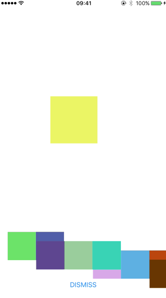</td>
<td>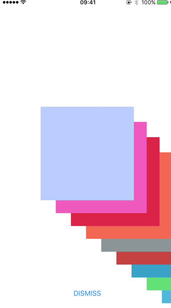</td>
<td>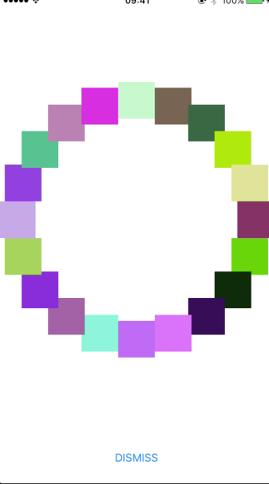</td>
<td>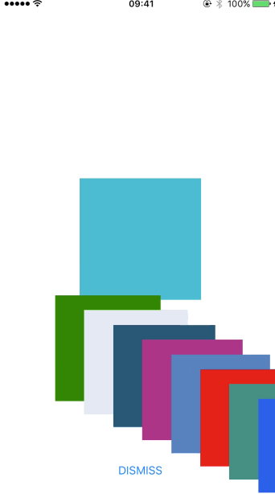</td>
</tr>
</table>

<table>
<tr>
<th>StageAndCircle</th>
<th>TimeMachineAndCircle</th>
</tr>
<tr>
<td>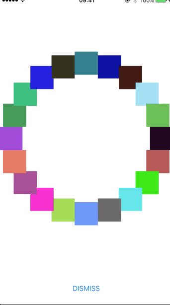</td>
<td></td>
</tr>
</table>

#### CollectionViewTimeMachineLayout — [Demo README](https://github.com/ParsifalC/CPCollectionViewKit/blob/master/Demos/CPCollectionViewTimeMachineLayoutDemo/README.md)
<table>
<tr>
<th>Left</th>
<th>Right</th>
<th>Top</th>
<th>Bottom</th>
</tr>
<tr>
<td>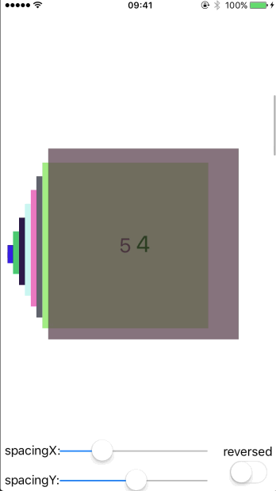</td>
<td>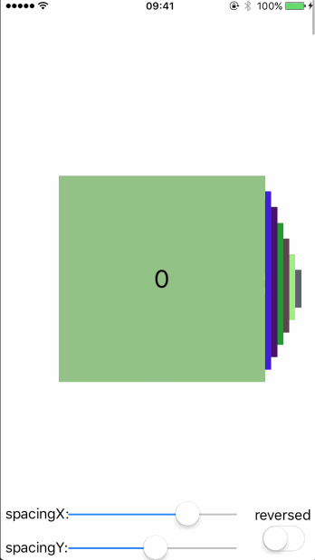</td>
<td>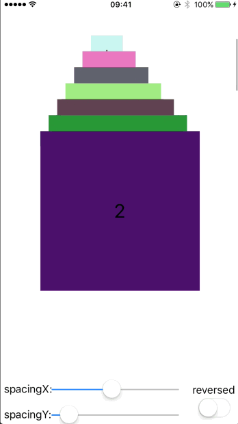</td>
<td>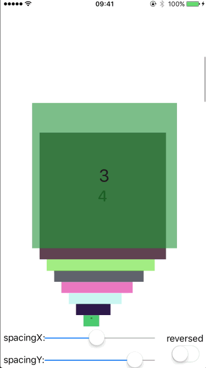</td>
</tr>
<tr>
<th>Reversed</th>
</tr>
<tr>
<td>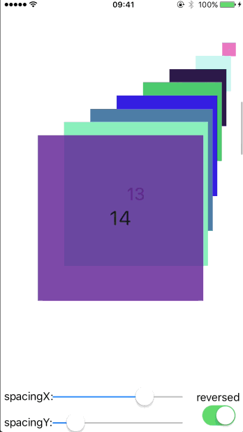</td>
</tr>
</table>

#### CollectionViewWheelLayout — [Demo README](https://github.com/ParsifalC/CPCollectionViewKit/blob/master/Demos/CPCollectionViewWheelLayoutSwiftDemo/README.md)
<table>
<tr>
<th>LeftBottom</th>
<th>RightBottom</th>
<th>LeftTop</th>
<th>RightTop</th>
</tr>
<tr>
<td>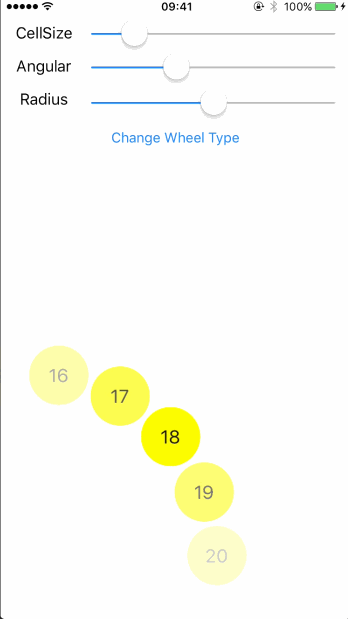</td>
<td>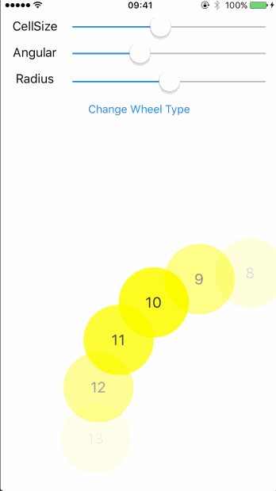</td>
<td>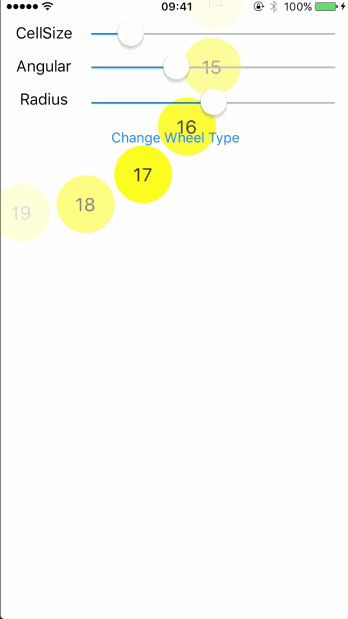</td>
<td>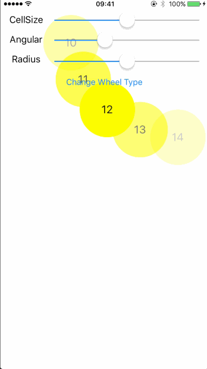</td>
</tr>
<tr>
<th>LeftCenter</th>
<th>RightCenter</th>
<th>TopCenter</th>
<th>BottomCenter</th>
</tr>
<tr>
<td>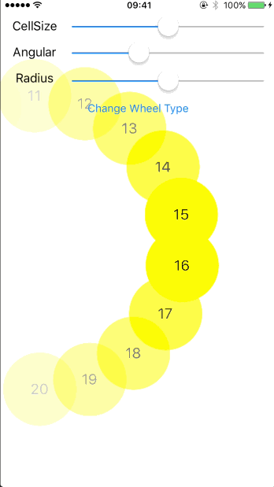</td>
<td>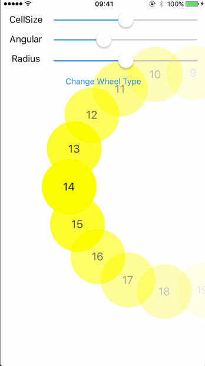</td>
<td>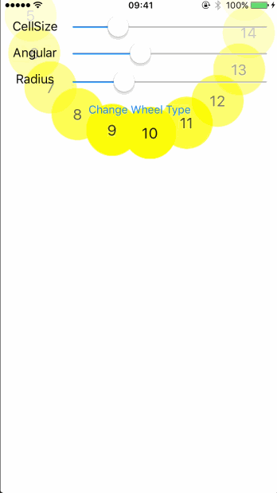</td>
<td>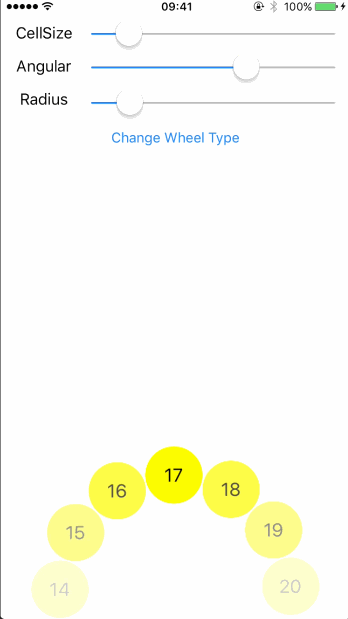</td>
</tr>
</table>

#### CollectionViewCardLayout — [Demo README](https://github.com/ParsifalC/CPCollectionViewKit/blob/master/Demos/CPCollectionViewCardLayoutDemo/README.md)
<table>
<tr>
<th>Zoominout</th>
<th>Rotateinout</th>
<th>Waltz</th>
<th>VerticalRotation</th>
</tr>
<tr>
<td>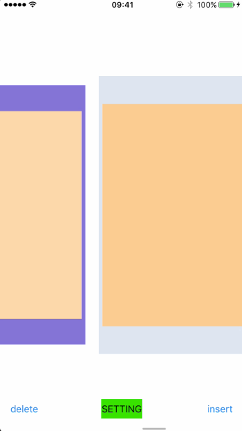</td>
<td>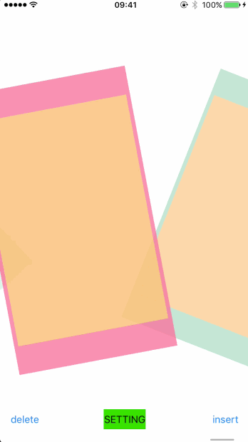</td>
<td>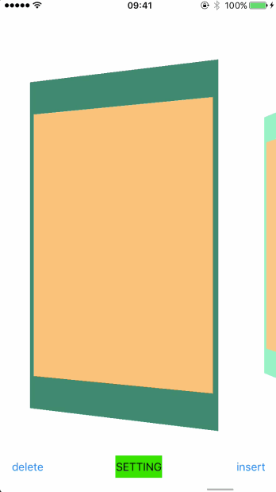</td>
<td>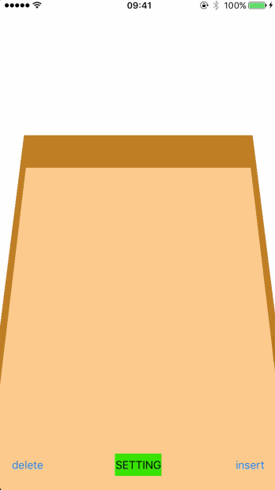</td>
</tr>
<tr>
<th>Cylinder</th>
<th>Somersault</th>
<th>Delete</th>
<th>Insert</th>
</tr>
<tr>
<td>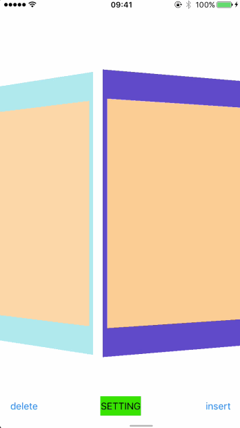</td>
<td>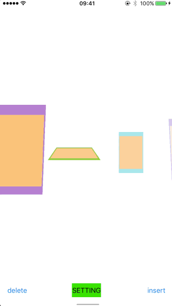</td>
<td>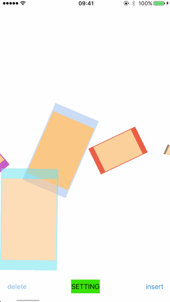</td>
<td>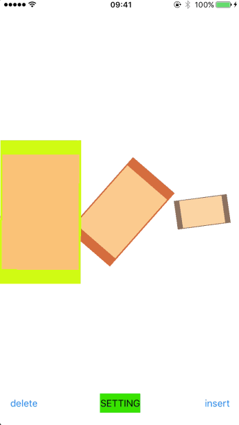</td>
</tr>
</table>

#### CollectionViewStageLayout — [Demo README](https://github.com/ParsifalC/CPCollectionViewKit/blob/master/Demos/CPCollectionViewStageLayoutDemo/README.md)
<table>
<tr>
<th>Waltz</th>
<th>Somersault</th>
<th>Blend</th>
<th>FadeAway</th>
</tr>
<tr>
<td>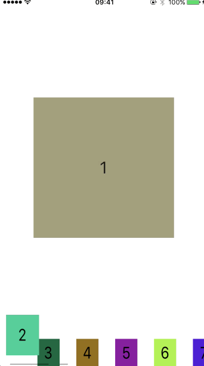</td>
<td>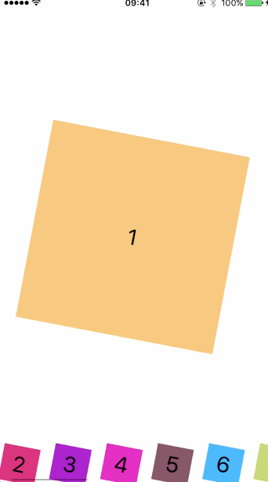</td>
<td>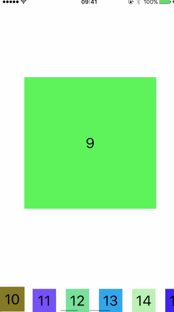</td>
<td>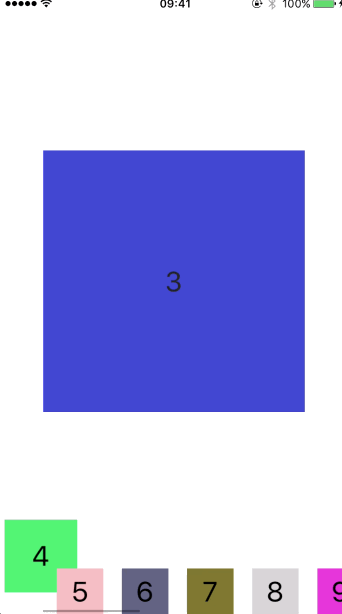</td>
</tr>
</table>

#### CollectionViewCircleLayout — [Demo README](https://github.com/ParsifalC/CPCollectionViewKit/blob/master/Demos/CPCollectionViewCircleLayoutDemo/README.md)
<table>
<tr>
<th>Circle</th>
<th>DeleteCustom</th>
<th>InsertCustom</th>
<th>InsertBase</th>
</tr>
<tr>
<td>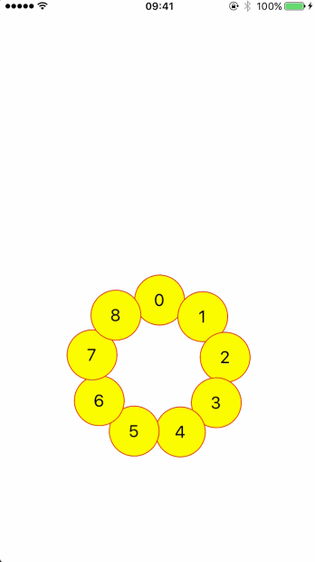</td>
<td>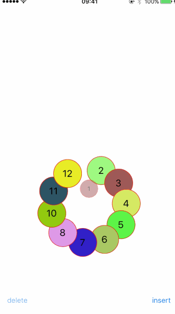</td>
<td>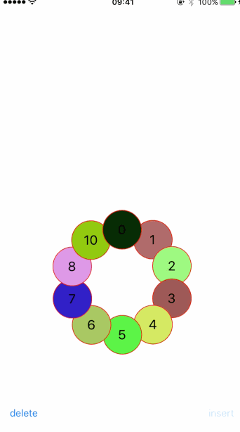</td>
<td>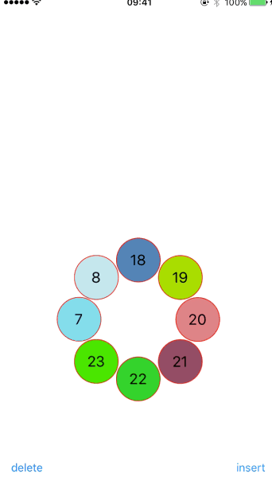</td>
</tr>
</table>

#### CollectionViewCaterpillarLayout — [Demo README](https://github.com/ParsifalC/CPCollectionViewKit/blob/master/Demos/CPCollectionViewCaterpillarLayoutDemo/README.md)
<table>
<tr>
<th>Caterpillar</th>
</tr>
<tr>
<td>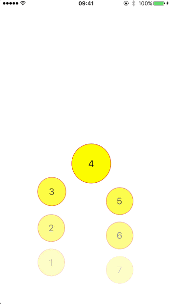</td>
</tr>
</table>

---

## Requirements

| Requirement | Minimum Version |
|---|---|
| iOS | 14.0 |
| Swift | 5.0 |
| Xcode | 13.0 |

> **Note:** All layouts currently support **section 0 only**.

---

## Installation

### Swift Package Manager (recommended)

Add the package to your `Package.swift` or via Xcode → **File → Add Package Dependencies**:

```
https://github.com/ParsifalC/CPCollectionViewKit
```

### CocoaPods

Add the following line to your `Podfile`:

```ruby
pod 'CPCollectionViewKit', '~> 1.0'
```

Then run:

```bash
pod install
```

---

## Running the Demo Projects

Clone the repo, then from the desired demo directory run:

```bash
# Install bundler dependencies (CocoaPods 1.15)
cd /path/to/CPCollectionViewKit
bundle install

# Install pod dependencies for a specific demo
cd Demos/CPCollectionViewCardLayoutDemo
bundle exec pod install

# Open the workspace
open CPCollectionViewCardLayoutDemo.xcworkspace
```

---

## Migration Guide (from 0.x)

The following API names have been corrected in v1.0.0. Deprecated aliases remain available
and will emit a compile-time warning guiding you to the new names:

| Old Name | New Name |
|---|---|
| `CardScrollDiretion` | `CardScrollDirection` |
| `MoveAnimationStyle.somefault` | `MoveAnimationStyle.somersault` |
| `WheelLayoutConfiguration.contentHeigthPadding` | `WheelLayoutConfiguration.contentHeightPadding` |

---

## TODO

- [ ] Usage documentation & code snippets
- [ ] Support `CollectionViewCaterpillarLayout` direction settings
- [ ] Unit Tests
- [x] Layout Transition
- [x] More Delete/Insert Animations
- [x] Swift Package Manager support
- [x] Fix deprecated API usage
- [x] Fix `layoutAttributesForElements` return bug in `CollectionViewTransitionLayout`

---

## Author

Parsifal, zmw@izmw.me

## License

CPCollectionViewKit is available under the MIT license. See the [LICENSE](LICENSE) file for more info.
